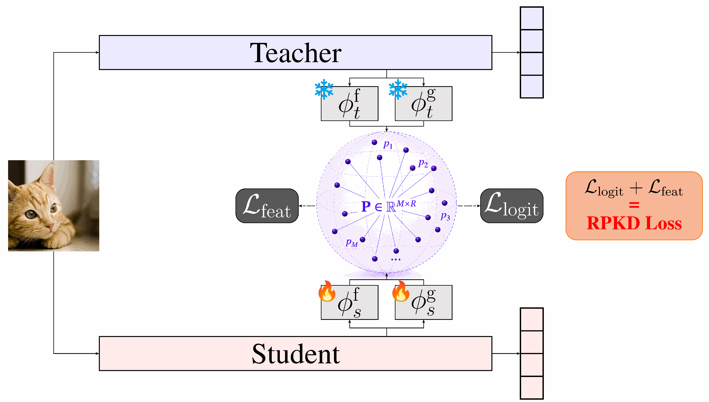

# You Don't Need Aligned Representations: Knowledge Distillation via Random Prototype Spaces

Official PyTorch implementation of **RPKD**, from the following paper: \
You Don't Need Aligned Representations: Knowledge Distillation via Random Prototype Spaces \
Hamza Etcibasi, Ramazan Gokberk Cinbis \
*NeurIPS 2026*

A widely held assumption in knowledge distillation is that teacher and student representations must occupy a compatible or explicitly aligned feature space. **RPKD** discards it. Both networks are compared against a shared bank of randomly initialized, **frozen** prototype vectors, so alignment happens in an external reference space rather than in the teacher's native feature coordinates. The teacher side is projected by fixed random maps that carry no trainable parameters, and only the student adapts.

Two branches carry the transfer: a **logit branch** that aligns global prototype similarity distributions, and a **feature branch** that matches spatially-resolved prototype activation maps. Because the prototype vocabulary is decoupled from the task label space, the supervisory signal does not collapse when the number of classes is small — an advantage logit-based methods lack.

<p align="center">
  
</p>

The teacher projects into the prototype matrix **P** through frozen random linear maps (❄), so it never needs updating; the student adapts through learnable MLP projectors (🔥) to match the teacher's prototype similarity patterns.

Over OFA, RPKD gains up to **+8.26%** on CIFAR-100, **+12.46%** on ImageNet-100, and **+1.34%** on ImageNet-1K.

If you find this project useful in your research, please cite:

```bibtex
@inproceedings{etcibasi2026rpkd,
  author    = {Hamza Etcibasi and Ramazan Gokberk Cinbis},
  title     = {You Don't Need Aligned Representations: Knowledge Distillation via Random Prototype Spaces},
  booktitle = {Advances in Neural Information Processing Systems},
  year      = {2026}
}
```

## Usage

First, clone the repository:

```bash
git clone https://github.com/HamzaEtcibasi/RPKD.git
cd RPKD
```

Then install the dependencies:

```bash
pip install -r requirements.txt
```

Our results are produced with `torch==2.3.1 torchvision==0.18.1 timm==0.6.5`. Note that **timm 0.6.5 is required** — later versions renamed the model-internal attributes that `custom_forward/` patches to expose intermediate features.

### Data preparation

Both datasets are read through timm's `ImageFolder` backend, so **CIFAR-100 is expected in image-folder layout**, not as the torchvision binary archive:

```
│path/to/cifar100/
├──train/
│  ├── apple/
│  │   ├── 0001.png
│  │   ├── ......
│  ├── aquarium_fish/
│  ├── ......
├──test/
│  ├── apple/
│  ├── ......
```

For ImageNet, download and extract the train and val images from http://image-net.org/:

```
│path/to/imagenet/
├──train/
│  ├── n01440764/
│  │   ├── n01440764_10026.JPEG
│  │   ├── ......
│  ├── ......
├──val/
│  ├── n01440764/
│  │   ├── ILSVRC2012_val_00000293.JPEG
│  │   ├── ......
│  ├── ......
```

The validation set defaults to `<data_dir>/test`; pass `--valdir` to point elsewhere (needed for ImageNet, whose split is named `val`).

### Teacher checkpoints

CIFAR-100 teachers are the ones released by OFA-KD and can be downloaded [here](https://github.com/Hao840/OFAKD/releases/tag/checkpoint-cifar100). For ImageNet, we use the standard timm weights of each architecture. Pass the checkpoint through `--teacher-pretrained`.

### Training

**CIFAR-100** — ViT-S teacher, MobileNetV2 student, 4 GPUs:

```bash
torchrun --nproc_per_node=4 train.py /path/to/cifar100 \
    --config configs/cifar/cnn.yaml \
    --model mobilenetv2_100 \
    --teacher vit_small_patch16_224 \
    --teacher-pretrained /path/to/teacher_checkpoint \
    --num-classes 100 \
    --distiller rpkd \
    --random-logit-w 10 --random-feat-w 50
```

**ImageNet-100** — the 100-class subset defined in `data/imagenet100_classes.txt`. Passing `--subset` also slices the 1000-way teacher head down to those classes:

```bash
torchrun --nproc_per_node=4 train.py /path/to/imagenet \
    --config configs/imagenet_subset/cnn.yaml \
    --model resnet18 \
    --teacher deit_tiny_patch16_224 \
    --teacher-pretrained /path/to/teacher_checkpoint \
    --valdir /path/to/imagenet/val \
    --dataset imagenet --subset \
    --distiller rpkd \
    --random-logit-w 10 --random-feat-w 10
```

**ImageNet-1K** — same recipe, without `--subset`:

```bash
torchrun --nproc_per_node=4 train.py /path/to/imagenet \
    --config configs/imagenet_subset/cnn.yaml \
    --model mobilenetv2_100 \
    --teacher deit_tiny_patch16_224 \
    --teacher-pretrained /path/to/teacher_checkpoint \
    --valdir /path/to/imagenet/val \
    --dataset imagenet \
    --distiller rpkd \
    --random-logit-w 1.0 --random-feat-w 1.0
```

Use `configs/cifar/vit_mlp.yaml` or `configs/imagenet_subset/vit.yaml` when the **student** is a transformer or MLP model — those recipes add mixup/cutmix, RandAugment and EMA.

Every run writes `summary.csv` (per-epoch metrics), TensorBoard logs, and a `result.txt` with the best score, so a batch of runs can be read at once:

```bash
grep -H best_top1 output/train/*/result.txt
```

### RPKD arguments

| argument | default | description |
|---|---|---|
| `--distiller rpkd` | — | selects RPKD |
| `--random-logit-w` | 10.0 | weight of the logit branch |
| `--random-feat-w` | 10.0 | weight of the feature branch |
| `--num-random-prototypes` | 500 | number of prototypes, `M` |
| `--random-embed-dim` | 256 | prototype dimension, `R` |
| `--random-logit-T` | 4.0 | temperature of the logit branch |
| `--normalize-feat-maps` | enabled | standardize each activation map over its spatial extent before comparing; turn it off with `--no-normalize-feat-maps` |

How the prototypes are constructed and seeded can also be changed, which is what the paper's prototype ablations vary; run `python train.py --help` for those.

### Choosing the loss weights

The two branch weights are the only values that need tuning, through a small grid search per teacher–student pair. As a starting point, the **1–50** range works for CIFAR-100 and ImageNet-100, while ImageNet-1K wants smaller values, around **0.1–1**, since the loss is spread over far more classes.

> **Swin students:** pass `--no-normalize-feat-maps`. Per-map standardization helps CNN and DeiT students, but makes training collapse when the student is a Swin variant. The flag is enabled by default, so only Swin runs need to turn it off.

### Custom usage

**KD algorithm**: create a new distiller following the examples in `distillers/`.

**Model architecture**: add it under `custom_model/`. If its intermediate features are needed for distillation, rewrite its `forward()` following the examples in `custom_forward/`.

## Acknowledgement

This repository builds on [OFA-KD](https://github.com/Hao840/OFAKD), and uses the [timm](https://github.com/rwightman/pytorch-image-models) and [mdistiller](https://github.com/megvii-research/mdistiller) libraries.
